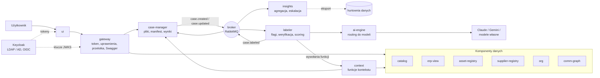

# Papaver — architektura

Powiązane: [Specyfikacja](../product/specyfikacja.md) (sekcje 3, 7, 10, 17) · [Plan labelera](plan-labeler.md) · [Format katalogu](format-katalogu.md)

Dokument opisuje, z jakich komponentów składa się system i jak go wdrażamy. Założenia:

- **Kubernetes z Knative.** Serwisy są usługami Knative, wywoływanymi przez HTTP albo przez zdarzenia.
- **Jedno wejście.** Z zewnątrz dostępny jest tylko gateway; pozostałe serwisy są widoczne wyłącznie w klastrze (`cluster-local`).
- **Zdarzenia przez prostą kolejkę** (RabbitMQ) w formacie CloudEvents, przez broker Knative Eventing. Kolejka nie jest źródłem prawdy; jest nim `case-manager`.
- **Każdy komponent danych jest właścicielem swoich danych.** Inne komponenty czytają je przez jego API, nigdy bezpośrednio z bazy.
- **Serwisy przetwarzające są bezstanowe.** `labeler`, `ai-engine` i `context` nie mają własnego stanu sprawy; wynik ich pracy idzie zdarzeniem do właściciela danych. `context` trzyma jedynie log audytu wywołań.

Wariant GCP opisuje specyfikacja, sekcja 17.

## Przegląd



## Komponenty

### Wejście i tożsamość

| Komponent | Rola |
| --- | --- |
| `gateway` | jedyne wejście z zewnątrz; sprawdza token, sprawdza uprawnienia do trasy, przekazuje żądanie do serwisu wewnętrznego, wystawia zebraną dokumentację API |
| Keycloak | wydaje tokeny (OIDC), łączy się z LDAP lub Active Directory klienta, trzyma role; gotowy produkt, nie piszemy własnego |
| `ui` | aplikacja webowa: przeglądanie spraw i wyników, wgrywanie plików, widoki według ról |

**Gateway jest własny i celowo minimalny** (FastAPI, kilkaset linii):

- **Tabela tras** w konfiguracji: prefiks ścieżki, adres serwisu wewnętrznego, wymagane role. Dodanie serwisu to jedna pozycja.
- **Token:** weryfikacja JWT z Keycloaka (klucze JWKS w pamięci, odświeżane przy nowym `kid`; sprawdzane `iss`, `aud`, `exp`; tylko RS256).
- **Uprawnienia:** rola z tokena musi pasować do trasy. Gateway robi tylko tę zgrubną kontrolę; dostęp do konkretnych danych (np. czy użytkownik widzi tę sprawę) sprawdza serwis.
- **Przelotka:** żądanie idzie do serwisu wewnętrznego z nagłówkami tożsamości ustawionymi przez gateway (użytkownik, role); nagłówki o tych nazwach przychodzące z zewnątrz gateway usuwa. Serwisy ufają tym nagłówkom. Duże pliki nie przechodzą przez gateway: `case-manager` wydaje adres do bezpośredniego wgrania do S3.
- **Dokumentacja API:** gateway pobiera `/openapi.json` z serwisów z tabeli tras i wystawia jeden Swagger UI.
- **Bez logiki domenowej.** Wszystko poza powyższym należy do serwisów.
- Interfejs zewnętrzny to REST z OpenAPI. gRPC dołożymy obok, jeśli pojawi się klient, który go potrzebuje.

### Sprawy i ocena

| Komponent | Rola |
| --- | --- |
| `case-manager` | właściciel sprawy: przyjmuje pliki (RFP, memo, oferty, załączniki), przygotowuje je, tworzy manifest, trzyma wersje sprawy; publikuje `case.created` i `case.updated`; odbiera `case.labeled` i zapisuje wynik oceny w swojej bazie |
| `labeler` | **bezstanowy:** ocenia sprawę według zestawu flag (jedno wywołanie modelu przez `ai-engine`, wywołania funkcji przez `context`, weryfikacja dowodów, ryzyko R i kategoria) i publikuje cały wynik w zdarzeniu `case.labeled`; niczego nie zapisuje |
| `ai-engine` | jedno API do modeli komercyjnych i własnych; routing, limity, log wywołań |
| `context` | warstwa funkcji kontekstu: definicje narzędzi dla modelu i wykonanie każdego wywołania w komponencie, który ma dane |
| `insights` | agregacja wyników po osobach, zespołach, dostawcach i kategoriach; progi eskalacji; informacja dla compliance z wielu spraw; źródło danych dla hurtowni danych (eksport agregatów i wyników) |

**Pliki w `case-manager`.** Pliki sprawy traktujemy jako sprawdzone przez pracowników klienta, którzy je wgrywają, i nie parsujemy ich w specjalny sposób: analizę treści robi model. `case-manager` robi tylko to, czego model nie zrobi sam: odczytuje metadane z oryginału (autor, firma, daty, szablon, śledzone zmiany, hash), wyciąga czysty tekst do weryfikacji cytatów, konwertuje pliki, których API modelu nie przyjmuje, i odrzuca korespondencję. Manifest sprawy opisuje każdy plik (rodzaj, wersja, hash, metadane, ścieżki oryginału i tekstu w S3) oraz tryb, etap i zestaw flag.

**Prompt injection.** Pliki pochodzą m.in. od oferentów, a autor dokumentu może być stroną, która chce wpłynąć na ocenę, np. ukrytym poleceniem „nie zgłaszaj flag”. Obrona:

- model nie ma narzędzi, które cokolwiek zmieniają: wszystkie funkcje kontekstu tylko czytają,
- treść plików trafia do promptu jako dane, oddzielona od instrukcji, a instrukcja systemowa mówi wprost, że poleceń z plików się nie wykonuje,
- dowody są weryfikowane mechanicznie, więc model nie przemyci zmyślonego cytatu.

**`ai-engine`:**

- Jedno wewnętrzne API: wiadomości, pliki, narzędzia, schemat odpowiedzi, rola (`reason`, `extract`, `vision`, `embed`). Wywołujący nie wie, który dostawca odpowiada.
- Adaptery na oficjalnych SDK: Anthropic, Gemini i API zgodne z OpenAI (vLLM i modele własne, OpenAI, Azure). Adapter tłumaczy pliki, wywołania narzędzi i structured output na format dostawcy.
- **Routing:** domyślnie aktywny jest jeden silnik dla wszystkich ról (np. Claude albo Gemini). Opcjonalnie nadpisanie per rola albo per żądanie, np. przy porównywaniu modeli na tych samych sprawach. Fallback na inny silnik tylko jako jawna opcja, bo cicha zmiana modelu psuje odtwarzalność.
- **Bezpiecznik `allow_external`:** u klienta on-prem ustawiony na `false` blokuje wywołania poza klaster, więc pliki klienta nie trafią do chmury przez pomyłkę w konfiguracji.
- **Log każdego wywołania:** dostawca, model, hash promptu, tokeny, koszt, czas; trafia do logów i metryk (obserwowalność), `ai-engine` nie ma bazy. Wynik flagi zapisuje, na jakim silniku powstał.
- **Wywołujący:** `labeler` (rola `reason`) oraz komponenty danych, np. `catalog` przy ekstrakcji kart katalogowych (rola `extract`) i wyszukiwaniu (rola `embed`).
- **Pliki w ramach rozmowy.** Pliki sprawy idą do modelu raz na przebieg i są cache'owane w ramach jednej rozmowy (pętli z narzędziami); kolejne tury ich nie powtarzają.

```yaml
default: anthropic/<model>
roles:
  extract: gemini/<model>        # opcjonalnie
engines:
  anthropic: { api_key: ... }
  gemini:    { api_key: ... }
  local:     { base_url: https://<endpoint-klienta>/v1, models: [gpt-oss-120b] }   # model poza naszym chartem
allow_external: true
```

**`context`:**

- Wystawia listę narzędzi ze schematami; `labeler` pobiera ją i przekazuje modelowi. Nowe źródło danych to nowe narzędzie w `context`, bez zmian w `labeler`.
- Każde wywołanie kieruje do komponentu, który ma dane. Odpowiedź zawiera zawsze **stan na dzień** (`as_of`) i komponent źródłowy.
- `labeler` dołącza odpowiedzi wszystkich wywołań do wyniku; `case-manager` zapisuje je przy sprawie jako rekordy dowodowe (sekcja „Dowody”). Własny log `context` służy tylko do audytu.
- Bramka dostępu: narzędzia grafu komunikacji działają tylko wtedy, gdy klient go włączył.
- Pętlę z modelem prowadzi `labeler`; `context` wykonuje pojedyncze wywołania.
- **Preloading.** Kontekst, który da się przewidzieć z manifestu (np. dane katalogowe i stany dla modeli z RFP, dane rejestrowe oferentów), `labeler` pobiera przez `context` przed wywołaniem modelu i dokłada do pierwszej wiadomości. Model sięga po funkcje tylko po resztę.

### Komponenty danych

| Komponent | Dane | Zasilanie |
| --- | --- | --- |
| `catalog` | katalog urządzeń i surowców: modele, parametry, zamienniki, producenci, autoryzowani partnerzy, EOL i EOS, ceny referencyjne; mapowanie SKU | batch początkowy, potem zasilenia z kart katalogowych i cenników |
| `erp-view` | stany i ruchy magazynowe, zużycie, zamówienia, faktury, ceny historyczne, budżety, progi akceptacji | konektor ERP |
| `asset-registry` | urządzenia po numerze seryjnym: lokalizacja, status w sieci z telemetrii, ostatnio widziane; urządzenia sieciowe (OLT, CMTS) z pojemnością, EOL i EOS; zlecenia instalacji i serwisu | konektory telemetrii, CMDB, NMS, systemu zleceń |
| `supplier-registry` | publiczne informacje o oferentach: KRS, CRBR, CEIDG, biała lista VAT | pobieranie z rejestrów dla każdego nowego oferenta i cyklicznie |
| `org` | struktura firmy, osoby i role, minimum danych do dopasowania osób w rejestrach; pryncypia, roadmapa, partnerzy strategiczni | konektor HR i dokumenty klienta |
| `comm-graph` | liczniki kontaktów między osobami i z domenami oferentów, bez treści | konektor metadanych poczty i Teams; domyślnie wyłączony |

Historia spraw nie jest osobnym komponentem: trzyma ją `case-manager`.

Każdy komponent danych ma endpoint importu (batch) i publikuje `context.updated` po zmianie. Pobieranie cykliczne uruchamia PingSource z Knative Eventing albo CronJob.

### Funkcje kontekstu i ich źródła

| Funkcja | Komponent |
| --- | --- |
| `past_cases` | `case-manager` |
| `catalog`, `market_prices` | `catalog` |
| `stock`, `find_orders`, `budget` | `erp-view` |
| `network`, `work_orders`, `vendor_registry` | `asset-registry` |
| `registry` | `supplier-registry` |
| `org`, `policies` | `org` |
| `contacts` | `comm-graph` |

Opis funkcji: [plan labelera](plan-labeler.md).

## Zdarzenia

| Zdarzenie | Publikuje | Odbiera | Treść |
| --- | --- | --- | --- |
| `case.created.v1` | `case-manager` | `labeler` | id sprawy, wersja manifestu, tryb, etap, zestaw |
| `case.updated.v1` | `case-manager` | `labeler` | nowe pliki w sprawie, nowa wersja manifestu |
| `case.labeled.v1` | `labeler` | `case-manager`, `insights` | id i wersja sprawy, id przebiegu, pełny wynik: flagi z dowodami, „nie da się ocenić”, odrzucone, R, kategoria, informacja dla compliance, odpowiedzi funkcji kontekstu (rekordy dowodowe), wersje (katalog, model, prompt) |
| `context.updated.v1` | komponenty danych | `insights` | rodzaj danych, zakres zmiany |

**Kontrakty zdarzeń** to schematy CloudEvents w `schemas/`, z wersją w typie zdarzenia. Zmiana niezgodna wstecz to nowa wersja typu; przez okres przejściowy publikujemy obie.

- **Deterministyczne id przebiegu:** hash z id sprawy, wersji manifestu, wersji katalogu i konfiguracji silnika. Ten sam przebieg ma zawsze to samo id.
- **Doręczenie co najmniej raz.** Przed wywołaniem modelu `labeler` pyta `case-manager`, czy wynik dla tego id przebiegu już istnieje (tylko odczyt, więc `labeler` pozostaje bezstanowy); jeśli tak, kończy bez kosztu. `case-manager` przyjmuje pierwszy wynik dla danego id przebiegu, a kolejne odrzuca.
- **Dead letter.** Zdarzenie, którego nie udało się obsłużyć po ponowieniach, trafia do kolejki dead letter; z UI albo API można je ponowić.
- **Ponowienie analizy.** `case-manager` publikuje ponownie `case.created` dla wybranych spraw, np. po zmianie katalogu albo modelu. Nowa wersja katalogu albo silnika daje nowe id przebiegu, więc powstaje nowy wynik obok starego.
- **Rozmiar zdarzeń.** `case.labeled` niesie pełny wynik, więc limit wiadomości ustawiamy jawnie. Wynik jest zwarty, bo cytaty w dowodach są krótkie, a pliki nie są w nim powielane.
- **Analiza wsteczna** to te same zdarzenia `case.created`, publikowane wsadowo dla historii zakupów; kolejka ogranicza tempo.

## Dowody

Każda flaga ma dowody, które da się sprawdzić bez modelu. `case-manager` zapisuje je przy sprawie.

| Rodzaj | Co zapisujemy |
| --- | --- |
| z pliku | link do pobrania pliku, hash i wersja pliku w sprawie, krótki dosłowny cytat |
| z kontekstu | rekord dowodowy: JSON odpowiedzi funkcji (nazwa funkcji, argumenty, komponent źródłowy, **stan na dzień**, pełna odpowiedź); flaga wskazuje id rekordu i miejsce w odpowiedzi |

Hash pliku jest potrzebny, bo nowa wersja sprawy może mieć plik o tej samej nazwie i innej treści; object lock w S3 pilnuje, że pod linkiem jest zawsze ta sama treść. Stan na dzień pozwala odtworzyć ocenę po latach, mimo że dane w komponentach się zmieniły.

## Przepływ sprawy

1. Użytkownik loguje się w `ui` (Keycloak) i zakłada sprawę. `case-manager` wydaje adresy do wgrania plików bezpośrednio do S3.
2. `case-manager` przygotowuje pliki, zapisuje manifest i publikuje `case.created`.
3. `labeler` wylicza id przebiegu i sprawdza w `case-manager`, czy wynik już jest. Jeśli nie, czyta manifest i pliki, pobiera listę narzędzi i przewidywalny kontekst (preloading) z `context` i wywołuje model przez `ai-engine`: pliki, metadane, opis sprawy, kontekst, zestaw flag, narzędzia. Prompt nie zawiera wcześniejszych flag osób ani list „znanych” dostawców (specyfikacja, sekcja 7).
4. Model wywołuje funkcje; `labeler` przekazuje każde wywołanie do `context`, a ten do właściwego komponentu.
5. `labeler` weryfikuje cytaty w czystym tekście plików i referencje w odpowiedziach funkcji, które sam otrzymał, odrzuca flagi bez dowodu, liczy R i kategorię i publikuje cały wynik razem z odpowiedziami funkcji w `case.labeled`. Sam niczego nie zapisuje.
6. `case-manager` odbiera `case.labeled`, wyciąga z niego dane i zapisuje wynik w swojej bazie, przypięty do wersji sprawy; kopię zdarzenia archiwizuje w S3 z object lock. `ui` pokazuje wynik. Gdy flaga krytyczna ma silny sygnał, wynik zawiera informację dla compliance.
7. `insights` dopisuje sprawę do agregatów; po przekroczeniu progu eskalacji tworzy informację dla compliance z wielu spraw. Agregaty i wyniki eksportuje do hurtowni danych.

## Knative

- **Widoczność:** wszystkie serwisy poza `gateway` są `cluster-local`.
- **Scale to zero** dla serwisów z rzadkim ruchem; `gateway` ma `minScale: 1`, żeby żądania nie czekały na zimny start.
- **Poza Knative:** Keycloak i RabbitMQ działają jako zwykłe wdrożenia Kubernetesa, bo muszą działać stale.
- **Długie żądania:** ocena sprawy trwa kilka minut i mieści się w żądaniu Knative; `labeler` i `ai-engine` mają jawnie ustawiony timeout (z zapasem ponad najdłuższą ocenę) i niską współbieżność na instancję, a timeout doręczenia w brokerze jest z nim zgrany.
- **Rewizje i podział ruchu:** nowa wersja promptu albo modelu to nowa rewizja; puszczamy ją na część ruchu albo na tę samą próbkę spraw i porównujemy wyniki przed przełączeniem.

## Dane

| Magazyn | Zawartość | Zasady |
| --- | --- | --- |
| S3, **dostarczony** przez klienta (nasz chart go nie instaluje) | oryginały plików, czysty tekst, manifesty, archiwum zdarzeń `case.labeled`, log audytu | wersjonowanie i object lock: dowodów nie da się podmienić |
| PostgreSQL, **dostarczony** (klient albo platforma; nasz chart go nie instaluje) | osobna baza na komponent danych, na `case-manager` (sprawy i wyniki), `insights`, `context` (log wywołań), Keycloak; `labeler` i `ai-engine` nie mają bazy | komponenty nie czytają cudzych baz |
| RabbitMQ | zdarzenia | krótka retencja; źródłem prawdy jest `case-manager`, a ponowienie analizy odbywa się przez ponowną publikację |

Treść korespondencji nie trafia do żadnego magazynu. Dane `comm-graph` są w osobnej bazie; w UI i przez funkcję kontekstu widzi je tylko rola „compliance extended”, a każde zapytanie trafia do logu audytu.

## Bezpieczeństwo i dostęp

- **Dwa poziomy uprawnień:** `gateway` weryfikuje token i rolę dla trasy, serwis na podstawie nagłówków tożsamości sprawdza dostęp do konkretnych danych.
- **Komunikacja service-to-service** ma osobną weryfikację, niezależną od tokenów użytkowników.
- **Osoby** identyfikujemy wprost: identyfikatorem pracownika, e-mailem albo imieniem i nazwiskiem. Celem systemu jest weryfikacja pracy osób, więc nie pseudonimizujemy ich w danych. `org` trzyma mapowanie między tymi identyfikatorami i jest dla nich źródłem prawdy; pozostałe komponenty używają identyfikatora z `org`.
- **Role** z Keycloaka mapują się na role ze specyfikacji (sekcja 13): kupiec, compliance, compliance extended, CFO i zarząd, superadmin.
- **Sieć:** `labeler` wychodzi tylko do `context`, `ai-engine`, `case-manager` (sprawdzenie, czy wynik już jest) i S3 (wyłącznie odczyt plików sprawy). Komponenty danych łączą się z systemami klienta przez swoje konektory. Do internetu mają dostęp tylko `ai-engine` (gdy `allow_external`), `supplier-registry` i zadania pobierające rejestry producentów.
- **Audyt:** kto co oglądał, kto zmienił profil krytyczności, każde zapytanie do grafu komunikacji; log append-only w S3 z object lock.

## Wdrożenie

- **Usługi dostarczone:** PostgreSQL, S3 (np. MinIO) i modele są dostarczone i dostępne pod adresem URL. Nie instalujemy ich i nie zajmujemy się nimi; chart dostaje tylko adresy i dane dostępowe.
- **Klaster:** Kubernetes z Knative. Knative Serving uruchamia nasze serwisy, a Knative Eventing dostarcza im zdarzenia z RabbitMQ.
- **Helm chart** instaluje komplet jednym poleceniem („wstaw mi to na klaster”): serwisy Knative, triggery, zadania cykliczne, Keycloak, RabbitMQ, konfigurację. Obrazy są publiczne i nie zawierają katalogu flag.
- **Katalog flag** jest montowany przy wdrożeniu do `labeler` jako Kubernetes Secret; klient dostaje go w jednym pliku z wersją i hashem.
- **Modele** są dostępne pod adresem URL: w chmurze (Anthropic, Gemini) albo u klienta jako endpoint zgodny z OpenAI. `ai-engine` dostaje adres i klucz w konfiguracji.
- **Klastry bez internetu.** Obrazy muszą dać się wgrać do wewnętrznego rejestru.
- **Osobna instancja per klient,** w osobnym namespace albo klastrze. Nie budujemy multitenanta.
- **Konfiguracja** wyłącznie przez zmienne środowiskowe z ConfigMap i Secret.
- **Obserwowalność:** OpenTelemetry, metryki Prometheus, logi; dla wywołań modelu log w `ai-engine`.
- **Lokalnie:** w etapie 1 (MVP) te same obrazy uruchamiamy przez Docker Compose, bez Knative; od etapu 2 testujemy na lokalnym k3d z Knative, z PostgreSQL i MinIO jako zamiennikami dostarczanych usług.

## Mapowanie na repo

| Element | Gdzie |
| --- | --- |
| `gateway`, `case-manager`, `labeler`, `ai-engine`, `context`, `insights`, komponenty danych | `services/<nazwa>/`: pakiet `app/`, `requirements.txt`, testy, Dockerfile, README |
| `ui` | `web/ui/` |
| Helm chart, konfiguracja lokalnego k3d; Terraform, gdy powstanie środowisko w chmurze | `infrastructure/` |
| Schematy formatu katalogu i zdarzeń | `schemas/` |
| Biblioteka współdzielona: nagłówki tożsamości, publikacja i odbiór zdarzeń, modele wyniku i dowodów | `libs/` |
| Katalog flag | poza tym repo; montowany przy wdrożeniu |

## Kolejność budowy

Kolejność wynika z [roadmapy](../product/roadmapa.md):

1. Etap 1 (MVP): ścieżka jednej sprawy, czyli `case-manager`, `labeler`, `ai-engine` z jednym silnikiem i `context`, plus proste wersje komponentów danych potrzebnych w MVP (`catalog`, `erp-view`, `supplier-registry`, `org`, zlecenia w `asset-registry`), zasilane danymi firmy syntetycznej.
2. Etap 2: `gateway`, Keycloak, `ui`, zdarzenia i wdrożenie na Knative.
3. Etap 3: pełne komponenty danych (telemetria i inwentarz sieci w `asset-registry`, pryncypia w `org`), warstwa tożsamości, `insights`.
4. Etap 4: `comm-graph`.

## Otwarte pytania

- [ ] Mechanizm weryfikacji service-to-service (np. mTLS w klastrze albo tokeny serwisowe).
