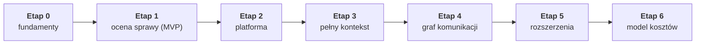

# Papaver — roadmapa

Powiązane: [Specyfikacja](specyfikacja.md) · [Zakres MVP](zakres-mvp.md) · [Architektura](../architecture/architektura.md)

Roadmapa układa rozwój systemu w kolejne etapy. Każdy etap kończy się działającą częścią systemu i warunkiem technicznym, po którym zaczynamy następny.

## Przegląd

| Etap | Co powstaje | Warunek zakończenia |
| --- | --- | --- |
| 0 — fundamenty | format katalogu flag z walidacją, monorepo, architektura | format i schematy gotowe, architektura uzgodniona |
| 1 — ocena sprawy (MVP) | `case-manager`, `labeler`, `ai-engine` z jednym silnikiem, `context`, proste wersje komponentów danych dla MVP, scoring, analiza wsteczna wsadowo | kryteria akceptacji z [zakresu MVP](zakres-mvp.md) |
| 2 — platforma | `gateway`, Keycloak, `ui`, zdarzenia przez kolejkę, Knative i Helm, rejestr decyzji | pełny przepływ sprawy przez UI na klastrze z Knative, instalacja jednym chartem |
| 3 — pełny kontekst | pełne `asset-registry` (telemetria, inwentarz sieci), `supplier-registry` z rejestrów publicznych, `org` z pryncypiami, warstwa tożsamości, konektory do systemów klienta, `insights` | funkcje kontekstu z danych firmy i rejestrów dostępne, agregacja i eskalacja działają, eksport do hurtowni |
| 4 — graf komunikacji | `comm-graph`: konektor metadanych poczty i Teams, liczniki kontaktów, bezpieczniki, funkcja kontekstu | graf zasilany z metadanych, dostęp tylko dla uprawnionej roli, każde zapytanie w logu audytu |
| 5 — rozszerzenia | moduł zakupowy, katalog surowców, kolejne zestawy branżowe, rejestry producentów | — |
| 6 — model kosztów | rekordy decyzji powiązane z eksploatacją, etykiety kosztów, czas do decyzji | kierunek |

## Etap 0 — fundamenty

- Format katalogu flag, walidacja i JSON Schema — zrobione.
- Monorepo: serwisy, infrastruktura, aplikacje, dokumentacja — zrobione.
- Architektura: komponenty, zdarzenia, wdrożenie na Kubernetesie z Knative — uzgodniona.
- Wybór pierwszej kategorii katalogu urządzeń.

## Etap 1 — ocena sprawy (MVP)

Szczegóły, kryteria akceptacji i to, co jest poza zakresem: [Zakres MVP](zakres-mvp.md).

| Kamień milowy | Zawartość | Wynik |
| --- | --- | --- |
| 1.1 Format flagi | definicja flagi w YAML, katalog z zestawami, schemat wyniku | zrobione: walidacja, schematy, testy |
| 1.2 `case-manager` | przyjęcie plików, metadane z oryginału, czysty tekst, konwersja, pomijanie korespondencji, manifest, zapis wyników | pliki sprawy gotowe do oceny |
| 1.3 `labeler` i `ai-engine` | jedno wywołanie modelu na sprawę, jeden silnik, weryfikacja cytatów, deterministyczne id przebiegu, CLI `labeler assess` | pierwsze flagi na samych plikach sprawy |
| 1.4 Firma syntetyczna | sprawy z plikami, historia zakupów, stany, wersja czysta i zabłocona | zestaw ewaluacyjny i pierwsza precyzja |
| 1.5 `context` i proste komponenty danych | funkcje: historia spraw, `catalog`, `erp-view` (stany, zamówienia, budżety), `supplier-registry`, `org` (struktura firmy i osoby), zlecenia w `asset-registry`; dane z firmy syntetycznej; preloading | flagi korzystające z kontekstu, pomiar H2 |
| 1.6 Katalog urządzeń | jedna kategoria, 5–10 producentów | funkcje kontekstu katalogu |
| 1.7 Analiza wsteczna | przebieg wsadowy po historii, etap „po zakupie” | zestawienie analizy wstecznej |
| 1.8 Scoring i raport | ryzyko R, kategorie A–D, informacja dla compliance, raport HTML | raport przykładowy |

Na tym etapie wszystko działa lokalnie przez Docker Compose.

## Etap 2 — platforma

- `gateway`: tabela tras, weryfikacja tokena, zebrana dokumentacja API.
- Keycloak z LDAP lub Active Directory; role ze specyfikacji.
- `ui`: przeglądanie spraw i wyników, wgrywanie plików, dwa tryby widoku (autor i compliance).
- Zdarzenia przez RabbitMQ i Knative Eventing, dead letter, ponowienie analizy.
- Wdrożenie: usługi Knative, Helm chart dla całości, PostgreSQL i S3 dostarczane z zewnątrz; klaster testowy to lokalny k3d z Knative.
- `ai-engine`: kolejne silniki i routing per rola, bezpiecznik `allow_external`.
- Rejestr decyzji i kalibracja pewności na jego danych.

## Etap 3 — pełny kontekst

- `asset-registry`: urządzenia po numerze seryjnym z telemetrii, urządzenia sieciowe z EOL i EOS (zlecenia są od etapu 1).
- `supplier-registry`: pobieranie z rejestrów publicznych dla każdego nowego oferenta i cyklicznie.
- `org`: konektor HR, pryncypia i roadmapa klienta.
- Konektory do systemów klienta dla wszystkich komponentów danych.
- Warstwa tożsamości: mapowanie SKU, osób i firm między źródłami.
- `insights`: agregacja po osobach, zespołach i dostawcach, progi eskalacji; championi zgodności; widok CFO i zarządu; eksport agregatów i wyników do hurtowni danych.

## Etap 4 — graf komunikacji

Graf korzysta z identyfikatorów osób z `org`, więc powstaje po pełnym kontekście. U klienta jest domyślnie wyłączony.

- `comm-graph`: konektor metadanych poczty i Teams (nadawca, odbiorcy, kanał, data; bez treści, tematu i załączników), miesięczne liczniki kontaktów.
- Bezpieczniki ze specyfikacji: wyłączenia, retencja, dostęp tylko dla roli „compliance extended”, log każdego zapytania.
- Funkcja kontekstu `contacts` w `context`, dostępna tylko przy włączonym grafie.

## Etap 5 — rozszerzenia

- Moduł zakupowy.
- Katalog surowców i kolejne zestawy branżowe.
- Rejestry producentów (S/N) w `asset-registry`.
- Zadania cykliczne w Airflow, gdy zależności między nimi urosną.

## Etap 6 — model kosztów firmy

- Rekordy decyzji powiązane z eksploatacją: użycie, magazyn, cena; etykiety kosztów.
- Znaczniki czasu etapów: czas do decyzji i wąskie gardła.
- Ludzie, media i obiekty jako kolejne strumienie kosztów obok sprzętu.
- Sieć, serwis terenowy, billing: droga od decyzji do przychodu.

## Decyzje według etapów

| Decyzja | Najpóźniej przed |
| --- | --- |
| Pierwsza kategoria katalogu urządzeń | etapem 1 |
| Model chmurowy do testów i model lokalny do jednego przebiegu | etapem 1 |
| Reakcja na kategorię D w analizie ciągłej (alarm czy wstrzymanie) | etapem 2 |
| Mechanizm weryfikacji service-to-service | etapem 2 |
| Zakres i bezpieczniki grafu komunikacji | etapem 4 |
