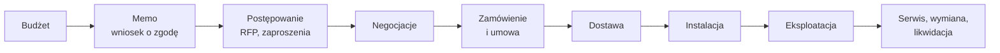
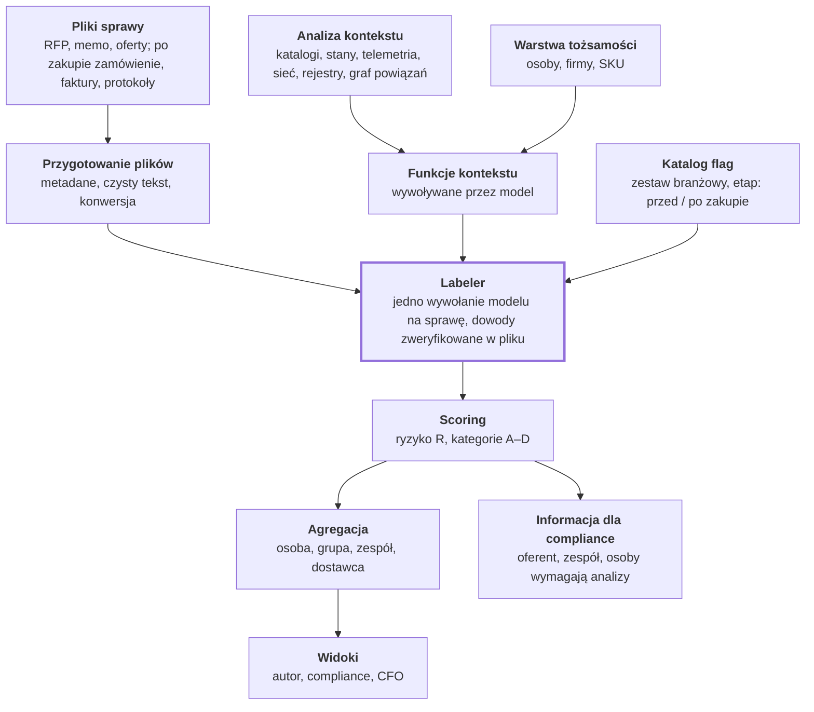

# Papaver — specyfikacja

Powiązane: [Roadmapa](roadmapa.md) · [Zakres MVP](zakres-mvp.md) · [Architektura](../architecture/architektura.md) · [Format katalogu](../architecture/format-katalogu.md) · [Plan labelera](../architecture/plan-labeler.md)

Rdzeń jest prosty: pliki sprawy wchodzą, a wychodzą flagi, każda z dowodem w źródle albo ze statusem „nie da się ocenić”. Dane spoza plików model pobiera przez narzędzia, a brak danych daje „nie da się ocenić”, nie wynik negatywny. Kierunek długoterminowy to cyfrowy model kosztów firmy. Pokazuje drogę od przychodu do zysku, a każdą decyzję kosztową oznacza jako konieczną, przepłaconą, marnotrawstwo albo fraud. Narzędzie nie oskarża. Zbiera sygnały i dowody, a decyzję podejmuje człowiek.

## 1. Cel i zasady

Papaver ocenia zakupy firmy: planowane, zanim zapadnie decyzja, i zrealizowane, w historii. Wynikiem są flagi z dowodem w źródle albo ze statusem „nie da się ocenić”. Co dokładnie wykrywamy, określa katalog flag, który nie jest częścią tego repo; tutaj opisujemy tylko strukturę flag i silnik, który je wykonuje.

**Zasady produktu:**

- **Zapobieganie zamiast szukania po szkodzie.** Głównym trybem jest analiza ciągła: sprawdzamy zakup, zanim zapadnie decyzja i wyjdą pieniądze. Analiza wsteczna (przy uruchomieniu u klienta) i analiza kontekstu są uzupełnieniem, a śledztwo zostaje poza narzędziem (sekcja 10).
- **Niechlujność to nie manipulacja.** Flaga podaje dowód i poprawkę, a ocenę intencji zostawiamy człowiekowi.
- **Akumulacja dowodów.** Pojedyncza flaga rzadko coś znaczy. Wartość daje agregacja po osobie, dziale, dostawcy i kategorii w czasie, tak jak w ręcznym procesie.
- **Każda flaga ma dowód i propozycję poprawki.** Neutralne przeformułowanie zapisu zmienia narzędzie z „łapacza oszustów” w narzędzie do poprawy jakości dokumentów.
- **Pokazujemy też dobre praktyki.** Green flagi opisują dobre postępowania, a championi zgodności to osoby, które realnie wzmacniają proces.

- **Silnik otwarty, uruchamiany u klienta.** Firma uruchamia system na własnej infrastrukturze i z własnym modelem; dane zakupowe nie opuszczają jej środowiska.
- **Docelowo proces ciągły.** Narzędzie stopniowo buduje obraz tego, jak firma naprawdę działa. Treści komunikacji nie czyta.

## 2. Kierunek: cyfrowy model kosztów firmy

Sprawdzanie postępowań jest pierwszym kawałkiem większej mapy. Na górze jest przychód od klientów. W drodze do zysku wypływa on przez ludzi, sprzęt, media i obiekty, a na każdym etapie część pieniędzy ginie. Model działa jak lejek sprzedażowy, tylko po stronie kosztów: pokazuje, gdzie i dlaczego pieniądze wypadają.

**Cztery etykiety kosztu.** Każdy wypływ dostaje jedną z czterech etykiet.

| Etykieta | Znaczenie |
| --- | --- |
| Konieczny | koszt potrzebny i w cenie rynkowej |
| Konieczny, ale przepłacony | potrzebny, ale drożej niż niezależna referencja |
| Marnotrawstwo | niepotrzebny albo niewykorzystany |
| Fraud | celowe działanie potwierdzone śledztwem; etykietę nadaje człowiek w rejestrze decyzji |

System nigdy sam nie nadaje etykiety „fraud”. Proponuje „sygnał do wyjaśnienia”, a etykietę nadaje compliance po śledztwie.

**Łańcuch decyzji kosztowej.**



Każde ogniwo łańcucha to miejsce, w którym pieniądze mogą wyciec. Każde sprawdzamy niezależnym świadkiem, czyli źródłem, którego nie kontroluje osoba sprawdzana.

**Zakres.** Model kosztów to kierunek, nie zakres pierwszej wersji. Każde narzędzie dokłada kawałek mapy:

1. Papaver zapisuje każde postępowanie jako ustrukturyzowany rekord decyzji: kto prosi, po co, jakie były alternatywy, jakie stany, kto zaakceptował (to już jest JSON postępowania),
2. decyzje łączymy z tym, co stało się potem: czy sprzęt jest używany, czy leży w magazynie, czy cena była rynkowa; od tego momentu mierzymy marnotrawstwo, a nie tylko je flagujemy,
3. znaczniki czasu etapów dają czas do decyzji i pokazują, gdzie sprawy utykają,
4. sieć, serwis terenowy, billing i churn domykają drogę od decyzji do przychodu.

Pierwszy wycinek modelu: etap sprzętu i rok historycznych zakupów, z jedną kwotą na każdą etykietę („tyle przepłacone, tyle zmarnowane”).

## 3. Architektura



Labeler robi jedno wywołanie modelu na sprawę. Model dostaje pliki sprawy w całości, ich metadane jako tekst, zestaw flag z instrukcjami i funkcje, przez które sam sięga po kontekst (katalog urządzeń i surowców, historia spraw i zakupów, stany, telemetria, rejestry publiczne, graf powiązań). Kontekst przygotowuje cyklicznie analiza kontekstu (sekcja 10). Warstwa tożsamości łączy osoby, firmy i produkty z różnych źródeł. Scoring, kategorie i agregacja zamieniają flagi w mapę anomalii. Treści korespondencji narzędzie nie czyta.

## 4. Wejście modelu: pliki sprawy

**Sprawa** to jeden zakup: komplet plików postępowania (RFP, memo, oferty, a po zakupie zamówienia, faktury, protokoły) z opisem. W dokumentacji „sprawa” i „postępowanie” oznaczają to samo; w kodzie i zdarzeniach używamy `case`.

Osobnego enkodera nie ma. Labeler robi jedno wywołanie modelu na sprawę. Model dostaje:

- pliki sprawy w całości,
- metadane plików jako zwykły tekst,
- opis sprawy: tryb, etap, kategoria, osoby i role, jeśli są znane,
- zestaw flag z instrukcjami,
- funkcje, które może wywołać, żeby pobrać kontekst (sekcja 7).

Dla każdej flagi model wskazuje plik źródłowy i podaje krótki cytat. Odnośnik prowadzi do pliku, bez strony i akapitu. Model czyta całe pliki, więc nie potrzebujemy bazy wektorowej ani RAG na plikach sprawy; wyszukiwanie ma sens tylko w kontekście (katalog, historia).

**Przygotowanie plików.** Przed wywołaniem działają małe funkcje pomocnicze:

- **Metadane z oryginału:** autor, firma, ostatni edytujący, daty, szablon, śledzone zmiany, komentarze, hash SHA-256. API modeli zwykle tych pól nie widzą, a konwersja je niszczy, więc przekazujemy je modelowi jako tekst.
- **Czysty tekst:** służy do sprawdzenia, czy cytat z flagi naprawdę jest we wskazanym pliku. To proste wyszukanie tekstu, które chroni przed wymyślonym cytatem.
- **Konwersja, gdy jest potrzebna.** API w chmurze przyjmują zwykle PDF, ale nie DOCX ani XLSX, więc te pliki konwertujemy. Modele lokalne przez API zgodne z OpenAI przyjmują głównie tekst; wtedy wejściem jest ten sam wyciągnięty tekst. Skany czyta model z obsługą obrazu, a dla modeli tekstowych potrzebny jest OCR.
- **Korespondencja jest pomijana.** Pliki maili i eksporty komunikatorów nie trafiają do modelu (sekcja 10).

**Pliki są niezaufane dla modelu.** Pliki traktujemy jako sprawdzone przez pracowników klienta i nie parsujemy ich w specjalny sposób, ale autor dokumentu (np. oferent) może próbować sterować oceną poleceniem dla AI ukrytym w pliku. Model nie wykonuje poleceń z plików i ma tylko narzędzia do odczytu ([architektura](../architecture/architektura.md)).

**Wersje dokumentów.** Model dostaje wszystkie wersje dokumentów w sprawie i sam je porównuje.

**Duże sprawy.** Gdy pliki nie mieszczą się w kontekście modelu (mały model lokalny), dzielimy zestaw flag na kilka wywołań na tych samych plikach. To wyjątek, nie zasada.

**Wewnętrzny model sprawy (minimum):**

- `CaseFile`: plik, rodzaj (RFP, memo, oferta, wniosek, zamówienie, faktura, protokół, inny), wersja, hash, metadane, czysty tekst.
- `Flag`: kod i wersja definicji, etap, stan, ocena, pewność z rozbiciem, dowody, wyjaśnienie, poprawka, wersje.
- `Entity`: sprawa, dostawca, producent, osoba, dział, opcjonalnie zespół.
- `PersonGroup`: osoby powiązane wspólnymi sprawami lub grafem komunikacji.
- `ComplianceSignal`: kod, osoba, dowód, skutek, status zatwierdzenia.

## 5. Flagi

Każda flaga to definicja, którą silnik wykonuje. Silnik jest otwarty i uruchomi dowolny zestaw definicji, ale nasz pełny zestaw jest zamknięty.

### Definicja flagi

| Pole | Co zawiera |
| --- | --- |
| Kod | np. `PRZYKLADOWA_FLAGA`; stały identyfikator w wynikach, raportach i rejestrze decyzji |
| Wersja | podbijana przy każdej zmianie tego, co flaga wykrywa |
| Flaguj, gdy | jednozdaniowy opis dla człowieka, kiedy flaga się zapala |
| Krytyczność domyślna | niska, średnia, wysoka, krytyczna; klient zmienia ją w profilu (sekcja 6) |
| Instrukcja | instrukcja dla modelu: czego szukać, co jest wyjątkiem, jak ocenić siłę sygnału, jakie cytaty zwrócić |

Format plików opisuje [Format katalogu](../architecture/format-katalogu.md). Definicja celowo nie zawiera trzech rzeczy:

- **Etapu.** Każdą flagę da się policzyć przed zakupem i po zakupie; etap jest parametrem przebiegu (sekcja 10).
- **Wymaganych danych.** Model pobiera dane przez narzędzia (niżej).
- **Reguł scoringu.** Wagi i progi są w profilu (sekcje 6 i 11), a wartości Δ w profilu kalibracji.

### Dane i narzędzia

Pliki sprawy model dostaje w całości (sekcja 4). Kontekst pobiera sam przez funkcje (function calling): historia spraw i zakupów, katalog urządzeń, ceny referencyjne, stany, telemetria, rejestry publiczne, graf powiązań. Każda warstwa kontekstu (sekcja 7) to kolejna funkcja, a jej dodanie nie wymaga zmian w definicjach flag. Treści korespondencji model nie dostaje.

- **Brak danych to nie wynik negatywny.** Jeśli narzędzia nie dają tego, czego flaga potrzebuje, stan to „nie da się ocenić” z powodem: brak dokumentu, brak warstwy, nieczytelny dokument, przekroczony kontekst modelu.
- **Warstwa może też tylko korygować pewność** (modyfikator). Nie tworzy wtedy nowej flagi, tylko podnosi albo obniża pewność flagi już istniejącej i dokłada argumenty za i przeciw.

### Wynik flagi

- **Stan:** wykryto, nie wykryto albo nie da się ocenić. Ostatni stan zawsze ma powód: brak dokumentu, brak warstwy, nieczytelny dokument, przekroczony kontekst modelu.
- **Ocena porządkowa siły sygnału:** słaby, umiarkowany, silny.
- **Pewność:** bazowa z kalibracji, modyfikatory warstw i wynik końcowy (niżej).
- **Status faktu:** potwierdzony w źródle, potwierdzony w danych kontekstu albo wnioskowany przez model.
- **Dowody:** plik (link do pobrania, hash) i krótki cytat albo rekord dowodowy z odpowiedzi funkcji kontekstu (ze stanem na dzień), ze statusem weryfikacji.
- **Argumenty za i przeciw** z warstw kontekstu.
- **Wyjaśnienie i proponowana poprawka zapisu.**
- **Tryb i etap:** analiza ciągła albo wsteczna; przed zakupem albo po zakupie (sekcja 10).
- **Wersje:** katalog, definicja flagi, hash instrukcji, model i endpoint, wersja przygotowania plików, digest obrazu, profil konfiguracji, data uruchomienia.

### Weryfikacja dowodu

Każdy dowód z dokumentu jest dosłownym cytatem. Silnik sprawdza dopasowaniem do czystego tekstu pliku (po normalizacji białych znaków i dzielenia wyrazów), czy cytat występuje we wskazanym pliku. Dowód z danych kontekstu wskazuje rekord dowodowy, czyli zapisaną przy sprawie odpowiedź funkcji (JSON ze stanem na dzień), a silnik sprawdza, że podana wartość w nim występuje.

- Niepotwierdzony dowód się nie liczy.
- Flaga bez żadnego potwierdzonego dowodu jest automatycznie odrzucana i trafia do logu jakości modelu.
- Czytający otwiera wskazany plik, wyszukuje cytat i sprawdza go sam. Wynik broni się w audycie i nie wymaga wiary w model.

To najtańszy bezpiecznik przeciw halucynacjom.

### Pewność

Pewność zgłaszana przez model jest słabo skalibrowana i niestabilna między modelami, dlatego model nie podaje liczby.

1. **Model daje dowód i ocenę porządkową.**
2. **Pewność bazowa p₀** to częstość potwierdzeń danej oceny dla danej flagi i danego modelu, liczona na zestawie testowym i w rejestrze decyzji. Do czasu kalibracji przyjmujemy wartości startowe: słaby 0,3, umiarkowany 0,6, silny 0,85.
3. **Modyfikatory warstw są addytywne w log-odds:**

```latex
\operatorname{logit}(p) = \operatorname{logit}(p_0) + \sum_k \Delta_k, \qquad |\Delta_k| \le 1, \quad \Big|\sum_k \Delta_k\Big| \le 2
```

Wartości Δ dla każdej pary flaga–warstwa trzymamy w profilu kalibracji, poza definicją flagi, i kalibrujemy je na zestawie testowym.

4. **Podpowiedź modelu to nie dowód.** Flaga oparta na parametrze z katalogu urządzeń albo na cenie referencyjnej, których nie potwierdzono w karcie katalogowej lub źródle ceny, ma pewność najwyżej 0,5.
5. **Raport pokazuje rozbicie**, np. „bazowo 0,60 · katalog +0,8 · stany +0,4 · polityka −0,6 → 0,73”. Bez rozbicia wynik „0,82” byłby nie do obrony.

### Odtwarzalność

Surowe flagi przechowujemy osobno od scoringu, ze wszystkimi wersjami. Dzięki temu da się:

- przeliczyć scoring na dowolnym profilu,
- odpowiedzieć w audycie, dlaczego pół roku temu postępowanie dostało D,
- porównać wyniki po zmianie modelu, promptu albo definicji.

Porównania między klientami liczymy na profilu domyślnym.

## 6. Katalog flag i profil konfiguracji

Katalog to wersjonowany zestaw plików YAML (jedna flaga na plik i indeks, który składa flagi w zestawy) i kontrakt produktu. Każda flaga ma kod, wersję, opis „flaguj, gdy”, krytyczność domyślną i instrukcję dla modelu. Format opisuje [Format katalogu](../architecture/format-katalogu.md). Pełna lista jest w osobnym, poufnym katalogu flag, który nie jest częścią tego repo. Klient dostaje katalog złożony w jeden plik z wersją i hashem.

**Zasady katalogu:**

- **Agregaty nie wchodzą do R pojedynczego zakupu.** Wzorce w czasie (analiza kontekstu) oceniają osobę, zespół, dostawcę lub grupę; w ocenie zakupu tylko wzmacniają flagi, bo inaczej ta sama historia liczyłaby się wielokrotnie.
- **Brak danych to nie wynik negatywny.** Jeśli narzędzia nie dają danych potrzebnych do oceny, flaga dostaje stan „nie da się ocenić” z powodem.
- **Podpowiedź modelu to nie dowód** (limit pewności 0,5, sekcja 5).
- **Treść korespondencji nie jest źródłem flag.** Powiązania sprawdzamy przez rejestry publiczne i graf komunikacji bez treści.
- **Uzasadnione wyjątki** opisuje instrukcja każdej flagi.

**Krytyczność w profilu konfiguracji.** Katalog mówi, co wykrywamy, a profil, jak bardzo to ważne dla danego klienta. Produkt dostarcza profil domyślny, zestaw branżowy może go zmienić, a klient dostosowuje go do siebie.

```yaml
profile: telco-klient-x
version: 3
based_on: domyslny-2026.11
severity:
  FLAGA_A: critical
  FLAGA_B: low
  FLAGA_C: high
escalation:
  cases_d_in_12_months: 2
  cases_c_in_12_months: 3
```

Konfiguracja jest też drogą do osłabienia kontroli, więc obowiązują bezpieczniki:

- **Wykrywanie nie zależy od profilu.** Obniżona lub wyłączona flaga nadal trafia do wyniku, a profil zmienia tylko jej wpływ na scoring.
- **Zmiany są kontrolowane.** Profil zmienia compliance lub audyt wewnętrzny, druga osoba akceptuje, a każda zmiana ma uzasadnienie i ślad w logu. Osoby prowadzące zakupy nie mają tego uprawnienia.
- **Raport pokazuje odchylenia:** wersję profilu i flagi ustawione poniżej profilu domyślnego.
- **Flag krytycznych w profilu domyślnym nie obniża się zwykłą zmianą profilu.** Wymaga to decyzji zarządu lub komitetu audytu, a raport pokazuje taką zmianę.

## 7. Warstwy kontekstu i poziomy zasilenia

Technicznie każda warstwa to narzędzie, które model wywołuje przez function calling: wyszukiwanie w katalogu, zapytanie o stany, historia zakupów, struktura firmy. Każda warstwa jest opcjonalna, a raport pokazuje pokrycie, czyli z których warstw korzystał i które flagi przez to nie dały się ocenić.

**Poziomy zasilenia.** Tryb podstawowy wymaga tylko plików sprawy. Kolejne poziomy można podłączać niezależnie. Dane z nich przygotowuje analiza kontekstu.

| Poziom | Klient dostarcza | Co dochodzi |
| --- | --- | --- |
| 0 — pliki | pliki sprawy; opcjonalnie dokumenty pryncypiów, roadmapy i listy partnerów | ocena na samych plikach; nasze katalogi i rejestry publiczne |
| 1 — magazyn i zakupy | `Item`, `StockSnapshot`, `StockMovement`, historia zamówień i faktur, `BudgetLine` | funkcje kontekstu: stany, zużycie, zamówienia, ceny historyczne, budżety |
| 2 — proces | historia spraw (`Tender`, `Bid`, RFP, memo), `ApprovalEvent`, umowy i aneksy, struktura firmy | funkcje kontekstu: historia spraw, struktura firmy, obieg akceptacji |
| 3 — sprzęt w sieci | `SerialUnit` z telemetrii, CMDB i NMS, `NetworkElement`, `WorkOrder`, `SiteAccess`, `VendorRegistration` | funkcje kontekstu: urządzenia w sieci, inwentarz sieci, zlecenia |
| Graf | `CommEdge`: metadane maili i Teams | funkcje kontekstu: liczniki kontaktów (sekcja 9) |

Brak warstwy nie jest błędem: flaga, która jej potrzebuje, zwraca „nie da się ocenić: brak warstwy X”.

**Pryncypia i standardy klienta.** Pryncypia, projekty, roadmapę i listę partnerów strategicznych klient może podać jako zwykłe dokumenty (PDF, wiki). Model wyciąga z nich reguły (`Principle`, `PlanItem`, `StrategicPartner`), dostępne potem jako kontekst. Zwykle nie są spisane, więc wdrożenie zaczyna się od ich spisania.

**Bez uprzedzeń w prompcie.** Model dostaje kontekst tylko przez funkcje i tylko dane faktów (ceny, stany, rejestry, wcześniejsze sprawy). Prompt nie zawiera list „znanych” nieuczciwych dostawców ani osób, a wcześniejsze flagi tej samej osoby nie są przekazywane do oceny nowej sprawy, żeby podejrzenia nie potwierdzały same siebie. Łączy je dopiero agregacja.

## 8. Warstwa tożsamości

Te same problemy z dopasowaniem dotyczą produktów, osób i firm, więc rozwiązujemy je jednym wspólnym komponentem, a nie osobno w każdej warstwie.

- **Produkty:** SKU, model i part number między producentami i indeksami ERP. To samo urządzenie bywa pod kilkoma indeksami, a bez mapowania stany są zaniżone.
- **Osoby:** struktura firmy, obieg dokumentów, ERP, metadane plików, graf komunikacji, KRS. Osobę identyfikujemy wprost: identyfikatorem pracownika, e-mailem albo imieniem i nazwiskiem. Celem systemu jest weryfikacja pracy osób, więc nie pseudonimizujemy ich; mapowanie identyfikatorów trzyma `org`.
- **Firmy:** oferent i jego spółki powiązane, KRS, CRBR, biała lista VAT, domeny e-mail, spółki z grupy klienta.
- **Każde połączenie ma pewność i źródło.** Połączenie użyte we fladze krytycznej wymaga potwierdzenia przez analityka.

## 9. Graf powiązań (opcja)

Z komunikacji bierzemy tylko metadane: kto z kim się kontaktuje i jak często. Treści nie czytamy nigdy. Czyta ją wyłącznie człowiek w śledztwie, poza narzędziem (sekcja 10).

- **Wejście:** nadawca, odbiorcy, uczestnicy spotkań, kanał (mail, Teams) i data. Bez treści, tematu i załączników.
- **Graf:** krawędź między dwiema osobami ma wagę rosnącą z liczbą wiadomości. Liczniki trzymamy per kierunek i miesiąc.
- **Czyszczenie:** tę samą wiadomość z kilku skrzynek liczymy raz. Pomijamy konta systemowe i listy dystrybucyjne.
- **Pokrycie:** raport podaje skrzynki, kanały i okres. Brak krawędzi oznacza brak kontaktu w dostarczonych danych, a nie brak kontaktu w ogóle.
- **Wyłączenia:** graf nie obejmuje kontaktów z kanałem zgłoszeń sygnalistów, osobami prowadzącymi sprawy compliance, radcami prawnymi i związkami zawodowymi, bo sam fakt takiego kontaktu może ujawnić sygnalistę.
- **Dostęp:** nikt nie przegląda całego grafu. Dane odczytujemy tylko w kontekście konkretnej sprawy, osoby lub grupy, z zapisanym powodem i śladem w logu.
- **Retencja:** miesięczne liczniki z okna 24 miesięcy; surowe nagłówki usuwamy po agregacji.

**Bezpieczniki:**

- domyślnie wyłączone; klient włącza je dopiero po spisaniu celu i zakresu,
- pracownicy są informowani z wyprzedzeniem,
- metadane to też dane osobowe, więc podlegają tym samym zasadom co treść,
- zakres osób i kanałów wybiera klient,
- każde zapytanie jest logowane.

## 10. Tryby działania i etapy oceny

Papaver działa w czterech trybach.

| Tryb | Kiedy | Co robi | Wynik |
| --- | --- | --- | --- |
| Analiza ciągła | na bieżąco, dla nadchodzących zakupów | ocenia paczkę dokumentów planowanego zakupu (RFP, memo, oferty; rzadko komplet) razem z kontekstem | flagi z dowodami, poprawki zapisów i pytania do zamawiającego przed decyzją |
| Analiza wsteczna | najczęściej przy uruchomieniu u klienta | te same flagi na zrealizowanych zakupach, na pełniejszym zestawie dokumentów | zakupy, w których przeoczono nieprawidłowości; zestaw testowy dla analizy ciągłej |
| Analiza kontekstu | cyklicznie | zbiera i łączy dane: katalog urządzeń i katalog surowców, stany i zużycie, urządzenia końcowe w sieci i poza nią (S/N z telemetrii), urządzenia sieciowe per lokalizacja z EOL i EOS, publiczne informacje o oferentach, graf powiązań, agregację po osobach i dostawcach | kontekst dla analizy ciągłej i wstecznej |
| Śledztwo | ad hoc, półautomatycznie, prowadzi człowiek | poza zakresem narzędzia | — |

**Treść komunikacji nie jest źródłem flag.** Analiza ciągła i wsteczna patrzą na dokumenty zakupu i kontekst, w tym na powiązania (rejestry publiczne, graf komunikacji bez treści). Korespondencję czyta tylko człowiek w śledztwie.

**Informacja dla compliance.** Gdy flaga krytyczna ma silny sygnał albo wokół tego samego oferenta, zespołu lub osoby zbiera się kilka flag, wynik zawiera krótką informację „oferent | zespół | osoby wymagają analizy”, bez ocen i wniosków. O śledztwie decyduje compliance, poza narzędziem.

**Etapy.** W analizie ciągłej i wstecznej etap jest parametrem przebiegu, a nie cechą flagi: każdą flagę da się policzyć na obu etapach, a etap mówi modelowi tylko, jakich dokumentów może się spodziewać. Przed zakupem brak zamówienia czy faktury nie jest niczym podejrzanym.

| Etap | Typowe dokumenty | Efekt |
| --- | --- | --- |
| Przed zakupem | memo, RFP (także draft), lista zaproszonych, oferty, zestawienie negocjacji, wniosek o zamówienie, projekt umowy | poprawki zapisów i pytania do zamawiającego, zanim zapadnie decyzja |
| Po zakupie | zamówienie, umowa i aneksy, faktury, protokoły odbioru, dokumenty dostawy z S/N | audyt i agregacja |

Ocenę przed zakupem można powtarzać, gdy dochodzą dokumenty (najpierw draft RFP, potem oferty). Każda analiza to kolejna wersja pod tym samym identyfikatorem. Bez modułu zakupowego obsługuje to upload, a z modułem przebiegi uruchamiają się same.

Wzorce w czasie liczy agregacja. W ocenie zakupu nie są osobnymi flagami.

**Dwa tryby widoku.** Największa wartość jest przed publikacją, kiedy da się jeszcze poprawić zapis. Wtedy jednak autor mógłby przepuszczać dokument przez narzędzie, aż wyjdzie czysty.

- **Autor RFP** widzi tylko poprawki zapisów dla flag, które profil oznacza jako widoczne dla autora, bez oceny osoby.
- **Compliance** widzi wszystko, łącznie z historią przebiegów tego samego dokumentu. Wielokrotne przebiegi z „naprawianiem” flag niewidocznych dla autora same w sobie są sygnałem.

**Historia wersji.** Zachowujemy każdą wersję i każdą naprawioną flagę. Naprawiona flaga widoczna dla autora nie liczy się do progu eskalacji. Pozostałe naprawione flagi zostają w historii z niższą wagą.

## 11. Scoring i kategorie

Każda sprawa dostaje jedną liczbę: ryzyko R (0–100, wyżej znaczy gorzej). Z niej wynika kategoria A–D.

**Wagi z krytyczności:** niska 0,1; średnia 0,3; wysoka 0,6; krytyczna 0,9. Pewność p to pewność końcowa z sekcji 5. Ryzyko liczymy jak „ciągłe LUB”, żeby jedna mocna flaga wystarczyła, a wiele drobnych sumowało się z nasyceniem:

```latex
R = 100 \cdot \left(1 - \prod_{i \in \text{flagi postępowania, bez wzorców w czasie}} (1 - w_i p_i)\right)
```

| Krytyczność | Sama flaga przy p = 1 |
| --- | --- |
| niska | R = 10, B |
| średnia | R = 30, C |
| wysoka | R = 60, D (przy p < 1 zwykle C) |
| krytyczna | R = 90, D (od p ≈ 0,67) |

**Kategorie (jawne reguły):**

| Kategoria | Warunek | Znaczenie | Akcja |
| --- | --- | --- | --- |
| A — brak sygnałów | R < 10 | brak sygnałów w dostarczonym materiale | raport z green flagami |
| B — drobne uwagi | R 10–25 | pojedyncze słabe sygnały, zwykle do poprawy zapisu | lista poprawek zapisów |
| C — do wyjaśnienia | R 25–60 | sygnały wymagające odpowiedzi | pytania do zamawiającego |
| D — mocno podejrzane | R ≥ 60 | prawdopodobne sterowanie wynikiem | audyt pogłębiony, informacja dla compliance |

Kategoria A nie potwierdza uczciwości: oznacza tylko brak sygnałów w dostarczonym materiale.

**Kalibracja.** Zmanipulowanych postępowań będzie kilkanaście, za mało, żeby stroić progi kategorii bez przeuczenia. Dlatego:

1. mierzymy precyzję każdej flagi osobno, na zestawie testowym i w rejestrze decyzji,
2. kategorie A–D trzymamy na jawnych regułach powyżej,
3. progi startowe sprawdzamy na pierwszych 50 postępowaniach i zmieniamy tylko przez nową wersję profilu domyślnego,
4. po każdej zmianie modelu lub definicji puszczamy znane przypadki ponownie: zmanipulowane powinny lądować w D, czyste w A lub B.

**Agregacja i eskalacja.** Flagi i kategorie zbieramy po osobie, grupie powiązanych osób, dziale, zespole, dostawcy, producencie i kategorii zakupowej w oknie 24 miesięcy. Ta sama flaga w kilku plikach jednego postępowania liczy się raz. Próg startowy: 2 postępowania w D albo 3 w C u tej samej osoby, grupy lub dostawcy w 12 miesięcy, albo suma krytyczności flag powyżej wartości z kalibracji. Przekroczenie progu daje informację dla compliance (oferent, zespół, osoby wymagają analizy), a o śledztwie decyduje człowiek poza narzędziem.

## 12. Green flagi i championi zgodności

**Green flagi** to definicje w katalogu, w tej samej strukturze co pozostałe flagi; opisują dobre praktyki i trafiają do raportu. Nie obniżają R.

**Championi zgodności** to sygnały o osobach, które realnie wzmacniają proces, z dowodem i agregacją w czasie, tak jak flagi. Ich definicje też są w katalogu. Zasady:

- **Osobno od red flag.** Sygnały pozytywne nie kasują red flag i nie liczymy wyniku netto.
- **Skutek zamiast liczby sprzeciwów.** Liczymy interwencje z potwierdzonym efektem, w relacji do liczby postępowań, żeby nie nagradzać blokowania zakupów.
- **Zatwierdza człowiek.** System proponuje, compliance potwierdza. To nie jest automatyczna ocena pracownicza.
- **Ograniczona widoczność.** Listę widzą compliance i zarząd, nie cała firma, bo osoba sprzeciwiająca się nieprawidłowościom może być narażona na odwet. Zgłoszenia sygnalistów nie są źródłem sygnału, a treści komunikacji nie skanujemy w poszukiwaniu championów.
- **Niezależność.** Osoba prowadząca audyt nie ocenia własnych interwencji.

## 13. Widoki, rejestr decyzji i role

**Widok dla compliance** to mapa miejsc, gdzie coś odbiega od normy, a nie lista podejrzanych. Na start pokazujemy liczby i trendy zamiast automatycznych alertów.

- **Agregacja** po osobie, zespole i dziale: liczba flag, średnie, rozkład A–D.
- **Normalizacja wolumenem:** flagi na postępowanie albo na milion złotych wydatków.
- **Porównanie z podobnymi:** każdy zespół względem normy swojej kategorii zakupowej (sieć kupuje inaczej niż administracja).
- **Trend w czasie** zamiast pojedynczych odczytów.
- **Alert** pojawia się dopiero, gdy wynik wyraźnie odstaje od normy kategorii; próg też kalibrujemy.

**Widok dla CFO i zarządu:** rozkład A–D w czasie, ekspozycja w złotówkach, koszty według czterech etykiet (sekcja 2). Bez danych osobowych.

**Rejestr decyzji.** Bez niego ta sama flaga wraca przy każdym postępowaniu danego zespołu, ludzie przestają czytać raport, a my tracimy najlepsze dane do kalibracji. Compliance oznacza każdą flagę jednym ze statusów:

- zasadna,
- uzasadnienie przyjęte (z opisem); przyjęte uzasadnienie jest pokazywane przy kolejnych wystąpieniach tej samej flagi,
- fałszywy alarm,
- potwierdzona po śledztwie; dopiero ten status pozwala nadać kosztowi etykietę „fraud”.

**Role** przypisuje osoba wdrażająca system, mapując je na grupy z katalogu klienta (SSO, OIDC).

| Rola | Uprawnienia |
| --- | --- |
| superadmin | konfiguracja wdrożenia; bez wglądu w wyniki, jeśli klient tak zdecyduje |
| kupiec (autor) | wgrywa pliki i widzi poprawki zapisów dla flag widocznych dla autora w swoim postępowaniu |
| compliance | wszystkie postępowania i pełne raporty, rejestr decyzji, zmiany profilu (z akceptacją drugiej osoby) |
| compliance extended | jak compliance oraz warstwy wrażliwe: graf powiązań |
| CFO i zarząd | agregaty, ekspozycja, etykiety kosztów, lista championów |

**Widok per osoba to profilowanie pracowników,** nawet jeśli widzi go tylko compliance. Raport nie podejmuje decyzji, a widok podlega tym samym bezpiecznikom co graf powiązań (sekcja 9).

## 14. Wynik: JSON sprawy

Klucze i wartości słownikowe są po angielsku, jak cały kod. Treść (cytaty, wyjaśnienia, poprawki) jest w języku dokumentów.

```json
{
  "schema_version": "2.0",
  "catalog_version": "2026.11+7cfb1bc695dd",
  "config_profile": "telco-klient-x@3",
  "engine": { "preprocessing": "0.1.0", "image_digest": "sha256:...", "model": "model-name", "endpoint": "..." },
  "mode": "continuous",
  "stage": "before",
  "analysis_version": 2,
  "case": { "id": "CASE-001", "name": "...", "category": "...", "value_pln": 1200000 },
  "department": { "name": "...", "source": "F-01" },
  "people": [
    { "id": "P-01", "role": "requester", "primary": true, "confidence": 0.9, "source": "F-01" },
    { "id": "P-02", "role": "approver", "primary": false, "confidence": 1.0, "source": "F-03" }
  ],
  "manufacturers": ["..."],
  "suppliers": ["..."],
  "files": [
    { "id": "F-01", "name": "memo.docx", "kind": "memo", "sha256": "...", "version": 1, "uri": "...",
      "metadata": { "author": "...", "company": "...", "created": "...", "modified": "..." } }
  ],
  "flags": [
    {
      "code": "FLAGA_A",
      "definition": "FLAGA_A@3",
      "instructions_sha": "...",
      "state": "detected",
      "severity": "high",
      "strength": "strong",
      "confidence": {
        "base": 0.85,
        "modifiers": [{ "layer": "order_history", "delta": 0.4, "argument": "..." }],
        "final": 0.89
      },
      "fact_status": "confirmed_in_source",
      "evidence": [
        { "file": "F-01", "quote": "...", "verified": true },
        { "context_record": "C-01", "path": "items[0].free_qty", "value": 120, "verified": true }
      ],
      "explanation": "...",
      "proposed_fix": "..."
    }
  ],
  "not_assessable": [
    { "code": "FLAGA_B", "reason": "missing_document", "details": "..." },
    { "code": "FLAGA_C", "reason": "missing_layer", "details": "erp" }
  ],
  "rejected": [{ "code": "FLAGA_D", "reason": "evidence_not_verified" }],
  "compliance_signals": [
    { "code": "SYGNAL_A", "person": "P-02", "strength": "strong",
      "evidence": [{ "file": "F-01", "quote": "...", "verified": true }],
      "effect": "..." }
  ],
  "context_records": [
    { "id": "C-01", "function": "stock", "arguments": { "product": "..." }, "source": "erp-view",
      "as_of": "2026-11-20", "response": { "items": [{ "sku": "...", "free_qty": 120 }] } }
  ],
  "context_used": ["order_history"],
  "coverage": { "files": "full", "stock": "no_data", "order_history": "partial" },
  "risk": 35,
  "category": "C",
  "compliance_note": null,
  "exposure_pln": { "excess": null, "overpayment": 84000 }
}
```

Pewność końcowa w przykładzie: logit(0,85) + 0,4 daje 0,89. Osoba główna może być pusta, jeśli nie da się jej ustalić z plików. `compliance_signals` to sygnały championów zgodności (sekcja 12), a nie red flagi.

## 15. Model danych klienta (kontrakt wejściowy)

Analizator nigdy nie czyta systemów klienta bezpośrednio. Dane wchodzą wyłącznie przez kanoniczny model: ustalony zestaw tabel w CSV lub Parquet, opisanych JSON Schema, wgrywanych do S3 i ładowanych do bazy (PostgreSQL on-prem albo BigQuery w wariancie GCP). Detektory są wspólne dla wszystkich klientów, a zmienia się tylko warstwa mapowania (IFS, Comarch XL, enova365, SAP…). Kanoniczny model jest też zalążkiem modelu kosztów firmy z sekcji 2.

| Tabela | Pola | Poziom |
| --- | --- | --- |
| `Item` | SKU, model, part number, kategoria funkcjonalna, powiązanie z katalogiem urządzeń lub surowców | 1 |
| `StockSnapshot` | SKU, magazyn, stan wolny, zarezerwowany, w drodze, data | 1 |
| `StockMovement` | typ (przyjęcie, wydanie, zwrot, przesunięcie), ilość, data, projekt | 1 |
| `OrderLine` | zamówienie, SKU, ilość, cena jednostkowa, rabat, dostawca, data | 1 |
| `BudgetLine` | pozycja budżetu, kwota, okres, właściciel, próg akceptacji | 1 |
| `CostDecision` | memo: wnioskujący, kwota, uzasadnienie, alternatywy, akceptujący, pozycja budżetu | 1 |
| `Tender` | postępowanie, zamawiający, tryb, daty, wartość | 2 |
| `Bid` | dostawca, zaproszony tak/nie, cena wyjściowa i końcowa, runda | 2 |
| `Invoice`, `Contract` | faktury, umowy z aneksami | 2 |
| `ApprovalEvent` | kto, co, kiedy (z obiegu dokumentów) | 2 |
| `OrgUnit`, `Person`, `Vendor` | struktura firmy; osoba z identyfikatorem pracownika, e-mailem, imieniem i nazwiskiem | 2 |
| `PlanItem`, `StrategicPartner` | roadmapa, plan inwestycyjny, partnerzy i ich zakres | 0–2 |
| `SerialUnit` | S/N, MAC, SKU, data przyjęcia, lokalizacja docelowa, status w sieci z telemetrii, ostatnio widziany | 3 |
| `NetworkElement` | typ (np. OLT, CMTS), lokalizacja, model, pojemność i wykorzystanie, EOL, EOS | 3 |
| `WorkOrder` | zlecenie instalacji lub serwisu, wykonawca, daty otwarcia i zamknięcia | 3 |
| `SiteAccess` | wejścia do obiektów, GPS techników (zakres ustala klient) | 3 |
| `VendorRegistration` | S/N, producent, konto lub kontrakt klienta, status gwarancji, data sprawdzenia | 3 |
| `CommEdge` | osoba A, osoba B, dostawca, kanał, miesiąc, liczba wiadomości w każdym kierunku | graf |

Brakujące pole nie daje flagi, tylko stan „nie da się ocenić”. Raport zawsze pokazuje pokrycie.

**Konektory.** Każdy system kontekstowy ma konektor. Konektor zapisuje surowe dane w S3, normalizuje je do kanonicznego modelu i publikuje zdarzenie `context.updated`; uruchamia go zdarzenie albo zadanie cykliczne. Kontrakt konektora jest częścią otwartego modelu danych, więc klient może dopisać własny.

## 16. Modele

Labeler ma rdzeń (format flagi, prompty, weryfikacja dowodów, publikacja wyniku) i jest bezstanowy; wynik zapisuje `case-manager` ([architektura](../architecture/architektura.md)). Modele wywołuje przez `ai-engine`, który ma adaptery Anthropic, Gemini i API zgodnego z OpenAI oraz routing: domyślnie jeden aktywny silnik, opcjonalnie inny dla wybranej roli. Konfiguracja to `base_url`, `api_key` i nazwa modelu, osobno dla każdej roli:

- `reason`: ocena sprawy, czyli jedno wywołanie z plikami, flagami i funkcjami kontekstu (wymagany structured output wyniku i function calling); także treść raportu,
- `extract`: ekstrakcja danych do JSON Schema poza oceną sprawy, np. karty katalogowe do katalogu urządzeń (wymagany structured output),
- `vision`: skany dokumentów i zdjęcia,
- `embed`: wyszukiwanie w katalogach i historii,
- `rerank` (opcjonalnie): trafność wyszukiwania.

Działa z vLLM, Ollama, LiteLLM, Vertex AI i Azure OpenAI. Każdy podpięty model przechodzi zestaw ewaluacyjny (20–30 postępowań z ręcznie oznaczonymi flagami), a raport podaje, na jakim modelu i z jaką trafnością powstał.

**Modele są dostarczone.** Każdy model jest dostępny pod adresem URL (w chmurze albo u klienta); nie instalujemy go i nie zajmujemy się jego infrastrukturą. `ai-engine` dostaje adres, klucz i nazwę modelu.

**Modele do ewaluacji (październik 2026; lista zmienia się co kilka miesięcy, rozstrzyga ewaluacja):**

| Rola | Open-weight | Chmura |
| --- | --- | --- |
| `reason` | gpt-oss-120b; alternatywnie Qwen3.6-27B | Claude, Gemini |
| `extract` | gpt-oss-120b; Bielik 11B v3 przy trudnej polszczyźnie | Claude, Gemini |
| `vision` | Nemotron 3.5 Parse, PaddleOCR-VL-1.6 | Gemini |
| `embed` | BGE-M3, Nemotron 3.5 Embed | Vertex AI embeddings |
| `rerank` | Nemotron 3.5 Rerank 8B | — |

**Bez trenowania na danych klientów.** Na początku nie robimy fine-tuningu. Poprawiamy definicje flag, instrukcje i zestaw testowy.

## 17. Infrastruktura i wdrożenie

**Domyślnie on-prem u klienta, na Kubernetesie.** Komponenty, przepływ sprawy i szczegóły wdrożenia opisuje [architektura](../architecture/architektura.md).

- **Obrazy i Helm.** Każdy komponent to obraz Dockera, a komplet instaluje Helm chart. Obrazy są publiczne i nie zawierają definicji flag. Katalog flag jest montowany przy wdrożeniu (Kubernetes Secret). Obrazy muszą dać się wgrać do wewnętrznego rejestru, bo klastry bywają bez dostępu do internetu.
- **Knative.** Komponenty działają jako usługi Knative, a każda wersja to rewizja. Rewizje pozwalają puścić nowy prompt lub model na część ruchu i porównać wyniki. Analiza jednego postępowania trwa kilka minut, więc timeout ustawiamy jawnie.
- **Zadania cykliczne** (analiza kontekstu i konektory): import z ERP, struktury firmy i historii zakupów, telemetria i inwentarz sieci, rejestry publiczne, sprawdzanie S/N u producentów, przeliczanie agregacji i kalibracji. Na start Kubernetes CronJob albo PingSource z Knative Eventing; Airflow dokładamy, gdy zależności między zadaniami urosną.
- **Kolejka zdarzeń.** Knative Eventing z prostą kolejką (RabbitMQ), zdarzenia w formacie CloudEvents: `case.created` i `case.updated` (nowa sprawa albo nowe pliki), `case.labeled` (wynik), `context.updated` (nowe dane z konektora). Kolejka nie jest źródłem prawdy: ponowienie analizy, np. całej analizy wstecznej po zmianie katalogu, to ponowna publikacja zdarzeń przez `case-manager`; nieobsłużone zdarzenia trafiają do dead letter.
- **Storage.** S3 dostarczany przez klienta (np. MinIO, Ceph) trzyma pliki, manifesty i archiwum wyników, z wersjonowaniem i object lock, żeby dowodów nie dało się podmienić. PostgreSQL z pgvector, dostarczany przez klienta albo platformę, obsługuje sprawy i wyniki, widoki, rejestr decyzji i wyszukiwanie wektorowe w danych kontekstu.
- **Model** działa poza naszym wdrożeniem: w chmurze (Anthropic, Gemini) albo u klienta jako endpoint zgodny z OpenAI (np. vLLM). Nasz Helm chart go nie instaluje; `ai-engine` dostaje adres i klucz w konfiguracji.
- **Po stronie klienta:** SSO (OIDC).

**Wariant GCP** (dla klientów w chmurze). Komponenty mapują się wprost, bo Cloud Run wykonuje usługi w modelu Knative.

| On-prem | GCP |
| --- | --- |
| Knative Serving | Cloud Run |
| CronJob, PingSource, Airflow | Cloud Scheduler, Cloud Composer |
| Knative Eventing, RabbitMQ | Pub/Sub, Eventarc |
| MinIO lub Ceph z object lock | Cloud Storage z retencją i bucket lock |
| PostgreSQL z pgvector | Cloud SQL lub AlloyDB; BigQuery na agregaty i kanoniczny model |
| model klienta (endpoint zgodny z OpenAI) | Vertex AI (Gemini, Claude) |
| OIDC klienta | Identity-Aware Proxy z IdP klienta |

**Osobna instancja per klient.** Nie budujemy multitenanta. Dane i wyniki jednego klienta nigdy nie trafiają do instancji innego.

**Konfiguracja wdrożenia:** modele i endpointy dla ról, klucze, profil krytyczności, lista spółek z grupy, role użytkowników, konektory, klucze API rejestrów producentów (tylko odczyt, od strony firmy) i katalog flag.

## 18. Co jest w tym repo

| Element | Gdzie |
| --- | --- |
| Silnik: przygotowanie plików, labeler, warstwy kontekstu, tożsamość, scoring, agregacja, moduł zakupowy | to repo, Apache 2.0 |
| Kanoniczny model danych, format flagi, kontrakt konektora | to repo |
| Katalog flag: definicje i instrukcje dla modeli | poza tym repo; montowany przy wdrożeniu |
| Zestaw testowy, firma syntetyczna, progi, wartości Δ | poza tym repo |
| Katalogi urządzeń i surowców, mapowanie SKU, ceny referencyjne | poza tym repo |
| Zestawy branżowe i profile | poza tym repo |

Silnik działa u klienta, więc prompty są tam czytelne w chwili wykonania. Katalog szyfrujemy w transporcie i w spoczynku.

## 19. Moduł zakupowy (opcja)

Klient może zastąpić swoją platformę zakupową naszym modułem, bo to proste funkcje. Wtedy analiza ciągła na obu etapach uruchamia się bez uploadu, a dane procesu powstają natywnie.

| Funkcja | Wbudowana kontrola |
| --- | --- |
| Rejestr dostawców per kategoria | dane rejestrowe pobierane przy rejestracji |
| Tworzenie RFP z szablonu | ocena przed publikacją: kategoria D blokuje publikację, C wymaga uzasadnienia i akceptacji drugiej osoby |
| Zaproszenia | każda zmiana listy zaproszonych z uzasadnieniem w logu |
| Pytania i odpowiedzi | jeden kanał, odpowiedzi widoczne dla wszystkich oferentów |
| Składanie ofert | oferty zamknięte do terminu, znacznik czasu, hash pliku, zapis metadanych |
| Negocjacje i aukcja | wszystkie rundy w systemie |
| Rozstrzygnięcie | uzasadnienie wyboru; autor RFP, akceptujący i odbierający dostawę to różne osoby |
| Przekazanie do ERP | zamówienie do ERP; S/N z dostawy do rejestru urządzeń |

Zakres: firmy prywatne. Zamówienia publiczne muszą przechodzić przez e-Zamówienia, więc tam zostajemy przy analizie z uploadu.

## 20. Dane demo, zestaw testowy i rozwój

Cały przepływ pokazujemy bez danych klienta, na syntetycznej firmie telco. Publiczne przetargi służą tylko do testów przygotowania plików.

**Firma syntetyczna:**

- budżet, memo, RFP i oferty, historia spraw, stany i zużycie, historia zamówień i faktur, struktura organizacyjna, zlecenia instalacji, S/N z telemetrią, inwentarz sieci, katalog urządzeń i metadane komunikacji (bez treści),
- zaszyte przypadki do wykrycia, zdefiniowane w zamkniętym zestawie testowym,
- **wersja demo:** czysta, żeby przypadki było widać od razu,
- **wersja testowa:** celowo zabłocona, z duplikatami SKU, różnymi nazwami tego samego produktu i brakującymi polami. Demo pokazuje wtedy, jak model porządkuje SKU między producentami.

**Zestaw testowy plików:**

- e-Zamówienia i TED jako legalny korpus testowy dla przygotowania plików,
- zestaw testowy z naciskiem na zabałaganione pliki: skany, formularze w Excelu, wiele wersji RFP, śledzone zmiany,
- kilka zanonimizowanych korporacyjnych RFP jak najwcześniej, bo przetargi publiczne są bardziej sformalizowane niż korporacyjne,
- przypadki testowe z danych klienta, zanonimizowane i za jego zgodą.

**Walidacja.** Najmocniejszym zestawem jest analiza wsteczna na danych klienta: zrealizowane zakupy z wcześniejszymi ustaleniami jako przypadki pozytywne. Dane publiczne (e-Zamówienia, TED) służą do testów przygotowania plików, ale nie zawierają memo, ofert konkurencyjnych ani historii zakupów.

## 21. Plan budowy

Fazy, kamienie milowe i bramki opisuje [roadmapa](roadmapa.md), a zakres pierwszej fazy [zakres MVP](zakres-mvp.md).

## 22. Ryzyka

- **Zakres rośnie.** Pierwsza wersja to rdzeń plus katalog urządzeń jednej kategorii. Model kosztów to kierunek, a nie jej zakres.
- **Pliki korporacyjne** to największe ryzyko techniczne: skany, formularze w Excelu, wiele wersji, a przy dużych sprawach limit kontekstu modelu.
- **Fałszywe alarmy,** jeśli klient nie spisze swoich standardów.

## 23. Otwarte pytania

**Produkt**

- [ ] Pierwsza kategoria dla katalogu urządzeń: transceivery, serwery czy sprzęt abonencki?
- [ ] Czy wracamy do rozróżnienia jakość/integralność (widok autora, etykiety kosztów), a jeśli tak, to jako tag w profilu czy w raporcie?
- [ ] Czy część flag ma wymagać potwierdzenia analityka, zanim wejdzie do R?
- [ ] Analiza ciągła: czy kategoria D tylko alarmuje, czy wstrzymuje zakup? Jaki czas analizy jest akceptowalny dla zakupów?
- [ ] Championi zgodności: kto zatwierdza i kto widzi listę.
- [ ] Zakres danych o pracy techników w terenie (`SiteAccess`, GPS): minimum potrzebne.

**Technika**

- [ ] Rejestry producentów: które API (Cisco, Dell, HPE, Juniper i inne) pozwalają sprawdzić S/N wobec konta klienta, w jakim trybie i z jakimi limitami.
- [ ] Wartości Δ modyfikatorów i limity: start i sposób kalibracji.
- [ ] Zestaw ewaluacyjny: skąd prawdziwe zestawy z memo i ofertami poza firmą syntetyczną?
- [ ] Próg eskalacji i waga krawędzi tworząca grupę: wartości domyślne do kalibracji.

## Źródła

- [gpt-oss-120b — karta modelu (OpenAI)](https://developers.openai.com/api/docs/models/gpt-oss-120b.md)
- [Qwen: które modele mają otwarte wagi (Runpod)](https://www.runpod.io/articles/guides/run-qwen-3-on-runpod)
- [Bielik-11B-v3.0-Instruct — Hugging Face](https://huggingface.co/speakleash/bielik-11b-v3.0-instruct)
- [PaddleOCR-VL-1.6](https://www.paddleocr.ai/main/en/)
- [Najlepsze modele embeddingowe 2026 (BGE-M3, Qwen3-Embedding)](https://www.datallmlab.com/blog/best-embedding-models.html)
- [Nemotron 3.5 Parse — dokumentacja NVIDIA](https://docs.api.nvidia.com/nim/reference/nvidia-nemotron-3_5-parse)
- [Nemotron 3.5 Rerank 8B — dokumentacja NVIDIA](https://docs.api.nvidia.com/nim/reference/nvidia-nemotron-3_5-rerank-8b)
- [Nemotron 3.5 Embed — Hugging Face](https://huggingface.co/nvidia/Nemotron-3.5-Embed-1B-NVFP4)

